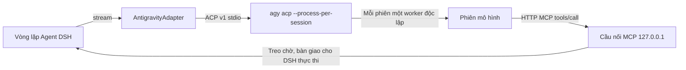

# dsh-llm-antigravity-acp (Bản Tiếng Việt)

[Tiếng Việt](./README.md) | [中文](./README.zh.md)


Tích hợp Google Antigravity CLI chính thức đã đăng nhập trên máy (`agy`) làm nhà cung cấp mô hình cấp 1 (primary model provider) cho DeepSeek Harness (DSH). Các mô hình sẽ xuất hiện trực tiếp trong trình chọn mô hình ở góc dưới bên phải khung nhập liệu của DSH, đứng ngang hàng với các provider kết nối trực tiếp như DeepSeek, GLM; toàn bộ các công cụ (tools), cơ chế phân quyền, nén ngữ cảnh và subagent đều do DSH quản lý và điều phối.

## Cơ chế hoạt động



| Thành phần | Cơ chế thực hiện |
|---|---|
| **Tiến trình** | `ctx.subprocess` khởi chạy `agy acp` chính thức trên máy; thông tin đăng nhập hoàn toàn nằm trong tiến trình chính thức và kho lưu trữ chứng chỉ hệ thống (macOS Keychain / Windows Credential Manager). |
| **Định danh Client** | ACP `clientInfo.name` sử dụng giá trị `jetbrains.dsh`. Antigravity chỉ phân phối các mô hình Claude và GPT-OSS cho các client nằm trong danh sách trắng (JetBrains, Zed, Xcode...); client thông thường sẽ chỉ nhìn thấy Gemini. |
| **Cô lập môi trường** | Sử dụng `--gemini-dir` độc lập (mặc định tại `$DSH_HOME/cache/antigravity-acp`), không tải các rule, skill hoặc MCP toàn cục của người dùng; agent `dsh-bridge` sử dụng cấu hình `tools: []` + `excludeDefaultComponents: true` nhằm loại bỏ hoàn toàn các công cụ tích hợp sẵn của Antigravity. |
| **Quản lý công cụ** | Các công cụ của DSH được mở qua endpoint MCP riêng cho từng phiên dưới dạng `mcp_dsh_<name>`; khi mô hình gọi công cụ, lượt gọi được tạm giữ (park), bước DSH hiện tại kết thúc với lý do `finish(tool-calls)`, DSH phê duyệt và thực thi rồi điền kết quả vào bước tiếp theo, lượt ACP ban đầu tiếp tục sinh nội dung. Khi phiên khởi tạo, khai báo `tools/list` của MCP được đóng băng nhằm cố định tiền tố giữ bộ nhớ đệm ẩn (implicit caching) của Gemini; việc mở khóa hoặc vô hiệu hóa công cụ giữa chừng không làm tạo lại phiên mà cập nhật trực tiếp danh sách trắng của host và gửi gia số Schema qua `<harness_tool_update>`, được gọi tại chỗ bởi `dsh_call_tool`. |
| **Công cụ chạy lâu** | `agy` có giới hạn tối đa 180 giây cho mỗi lượt gọi MCP đơn lẻ và bộ nhớ đệm ẩn của Gemini có thời gian nhàn rỗi (idle TTL). Theo mặc định, các lệnh gọi vượt quá 85 giây (`relayAfterMs`) sẽ trả về thông báo "vẫn đang chạy" (still running), mô hình sẽ gọi `dsh_await_result` để tiếp tục chờ kết quả và làm mới thời gian sống của cache, phía DSH chỉ nhìn thấy duy nhất một lần gọi công cụ. |
| **Lịch sử hội thoại** | Cùng một phiên DSH sẽ tái sử dụng cùng một phiên ACP, chỉ gửi phần đầu vào mới phát sinh; khi nén hội thoại, chỉnh sửa hoặc quay lại lịch sử, phiên sẽ được tái tạo theo lịch sử DSH (bản ghi `<dsh_history>` + đầu vào mới nhất). Việc phát lại tuân theo ngân sách byte ở phần đuôi: khi mở khóa là 2.2MB, khi chưa mở khóa là 160KB (thấp hơn ngưỡng cắt tỉa 192KB của một tin nhắn `USER_INPUT` trong agy), lược bỏ từ tin nhắn cũ nhất và chú thích rõ ràng trong khối, đầu vào mới nhất của người dùng luôn được giữ nguyên trọn vẹn. |
| **Prompt hệ thống** | Lần đầu được chèn qua `_meta.antigravity.systemPrompt.append`; khai báo `systemPromptUpdate: in-history`, những thay đổi về sau được gửi gia số dưới dạng `<system_update>`. |

> **Bối cảnh:** Dịch vụ ACP của Antigravity kiểm tra `clientInfo.name` theo danh sách trắng để phân phối mô hình của bên thứ ba (chỉ JetBrains / Zed / Xcode nhìn thấy, các client khác chỉ thấy Gemini), xem thảo luận tại [antigravity-cli#1318](https://github.com/google-antigravity/antigravity-cli/issues/1318); bản thân lệnh `agy models` và `agy -p --model` của CLI đã hỗ trợ các mô hình bên thứ ba này. Do đó, plugin chỉ sử dụng định danh thuộc danh sách trắng trong bắt tay ACP, hoàn toàn không sửa đổi nhị phân chính thức và không can thiệp vào trạng thái đăng nhập. Bảng tra cứu mô hình và gói dịch vụ có tại [Choose a model](https://antigravity.google/docs/models/).

## Đối chiếu trải nghiệm tính năng gốc

| Tính năng | Triển khai |
|---|---|
| **Cửa sổ ngữ cảnh** | Khai báo riêng cho từng mô hình: Gemini 4 Argon / 3.8 Flash và Claude Opus 5.5 sau khi mở khóa đạt `1.048.576` tokens (dùng chung cho input, thinking, output); khi chưa mở khóa là `256.000` tokens. Không khấu trừ trước `defaultMaxTokens`; DSH mặc định kích hoạt nén tại 80% cửa sổ. Tập lệnh mở khóa đồng thời mở Gate 4A/4B (gỡ bỏ giới hạn 64K / 192KB tin nhắn đơn bước `USER_INPUT`), hỗ trợ phát lại toàn bộ ngữ cảnh lịch sử lớn. |
| **Mức độ suy luận (Reasoning Effort)** | Ba mức: `Low` / `Medium` / `High`, ánh xạ trực tiếp sang `thought_level` của ACP, có thể chuyển đổi trong cùng một phiên mà không cần tạo lại. |
| **Luồng suy luận (Thinking Stream)** | Chuyển đổi `agent_thought_chunk` → khối reasoning hiển thị trong thời gian thực. |
| **Thống kê dung lượng & Đồng hồ đo ngữ cảnh** | Đọc dữ liệu chỉ đọc (read-only) qua `node:sqlite` từ bảng `steps` trong cơ sở dữ liệu `$home/agy/conversations/<sessionId>.db` của máy cục bộ (`step_type = 15` Protobuf `ModelUsageStats`). Báo cáo chính xác `TokenUsage` rời rạc cho từng bước tại mỗi bước `tool-calls` và bước dừng `stop` cuối cùng (`inputTokens` là đầu vào chưa hit cache, token đọc/ghi cache và output được tính độc lập vào tổng số), trực tiếp làm sáng bảng thống kê chi tiết của DSH và vòng tròn `ContextMeter` ở góc dưới. Tự động chuyển về ước lượng ở cuối lượt nếu không có cơ sở dữ liệu phiên. |
| **Subagent** | Mỗi cặp `(sessionId, purpose)` sở hữu một phiên ACP riêng biệt; trong thời gian phiên cha chờ công cụ, subagent có thể chạy song song; các tác vụ `spawn` / `fork` / `team` / `workflow`, tạo tiêu đề, tóm tắt nén không chặn lẫn nhau. |
| **Đầu ra dài** | Tự động viết tiếp (mặc định 3 lần) trong cùng một phiên khi gặp tín hiệu dừng `max_tokens`. |
| **Hình ảnh** | File đính kèm từ DSH được gửi dưới dạng khối ảnh ACP; ảnh do công cụ trả về được đưa vào lại dưới dạng nội dung ảnh MCP. |
| **Hủy & Thử lại** | Khi người dùng hủy, gửi `session/cancel` và giải phóng các lệnh gọi đang chờ; ánh xạ lỗi sang `AUTH` / `QUOTA` / `RATE_LIMIT` / `TIMEOUT` / `TRANSPORT` / `SERVER`, hỗ trợ cơ chế backoff retry từ `dsh-llm-retry`. |
| **Hạn mức gói (Quota)** | Viên con nhộng cạnh ô nhập ưu tiên hiển thị tỷ lệ còn lại hàng tuần của nhóm mô hình hiện tại, nhấp vào để mở rộng chi tiết hạn mức tuần và cửa sổ 5 giờ kèm đồng hồ đếm ngược đặt lại (`agy -p /usage`, không làm tiêu hao hạn mức mô hình); trang Cài đặt cũng đồng bộ hiển thị hạn mức gói, trạng thái kết nối và trạng thái mở khóa. |
| **Giao diện cài đặt** | Cửa sổ ngữ cảnh, mức suy luận mặc định, số lần tự động viết tiếp được tích hợp thành danh sách điều khiển thanh lịch: nhãn bên trái, giá trị hiện tại cùng biểu tượng `›` bên phải; nhấp chọn giá trị sẽ có hiệu lực ngay lập tức qua `configure`. |

## Cài đặt

**Điều kiện tiên quyết:** Đã cài đặt Google Antigravity CLI chính thức (`agy >= 1.5.0`, bản cũ nâng cấp bằng `agy update`) và đã chạy `agy` ít nhất một lần trong terminal để hoàn tất đăng nhập tài khoản Google.

### Cách 1: Cài đặt trực tiếp từ kho GitHub

```sh
dsh plugin --profile web add "git+https://github.com/shivertuan16-hash/dsh-plugin.git#main&path:/dsh-llm-antigravity-acp"
```

### Cách 2: Cài đặt từ mã nguồn cục bộ

```sh
cd dsh-llm-antigravity-acp
npm run build
cd ..
dsh plugin --profile web add ./dsh-llm-antigravity-acp
```

Sau khi khởi động lại giao diện Web của DSH, hãy chọn mô hình trong nhóm **Antigravity** tại trình chọn mô hình và chọn mức suy luận mong muốn.

### Mở khóa ngữ cảnh lên 1M

Việc cài đặt plugin sẽ không tự ý can thiệp vào tệp nhị phân `agy` chính thức; cửa sổ ngữ cảnh mặc định vẫn là 256K.  
Để mở khóa lên khoảng 1M token (983.040 tokens), sử dụng công cụ [`agy-context-unlock`](../agy-context-unlock) trong cùng repo:  
Đặt tệp `agy-patch.py` vào thư mục:
- macOS / Linux: `~/.gemini/antigravity/tools/agy-patch.py`
- Windows: `%USERPROFILE%\.gemini\antigravity\tools\agy-patch.py`

Khi plugin khởi động, tính năng `autoPatch` sẽ tự động tìm tệp tại đường dẫn này và tiến hành vá tệp `agy.exe`. Nếu không tìm thấy, hệ thống vẫn duy trì 256K mặc định an toàn. Khi `agy` được cập nhật bản mới, plugin sẽ tự động kiểm tra và vá lại.

| Mô hình | Cửa sổ ngữ cảnh | Mức độ suy luận |
|---|---|---|
| **Gemini 4 Argon** | 1.048.576 (sau khi mở khóa; chưa mở khóa là 256.000) | Low / Medium / High |
| **Gemini 3.8 Flash** | 1.048.576 (sau khi mở khóa; chưa mở khóa là 256.000) | Low / Medium / High |
| **Claude Opus 5.5** | 1.048.576 (sau khi mở khóa; chưa mở khóa là 256.000) | Low / Medium / High |

*Danh mục mô hình căn cứ theo `models.availableModels` do lệnh `session/new` của ACP trả về: các mô hình chưa được cấp quyền trong gói sẽ không hiển thị. Claude Sonnet 5.5 và GPT-OSS 120B mặc định được ẩn trong danh sách `HIDDEN_MODEL` của `catalog.ts`; xóa id tương ứng để hiển thị lại.*

## Bảng cấu hình

| Trường cấu hình | Giá trị mặc định | Giải thích |
|---|---|---|
| `provider` | `antigravity` | ID định tuyến nhà cung cấp |
| `command` | Trống | Đường dẫn tuyệt đối tới `agy`; để trống sẽ tự động tìm trong `PATH` hoặc các đường dẫn tiêu chuẩn của hệ điều hành |
| `home` | Trống | Thư mục cô lập; để trống mặc định là `$DSH_HOME/cache/antigravity-acp` |
| `contextWindow` | `0` | Ghi đè cửa sổ ngữ cảnh toàn cục; `0` là tự động theo mô hình (1.048.576 sau khi mở khóa, ngược lại là 256.000) |
| `defaultEffort` | `high` | Mức suy luận sử dụng khi yêu cầu không chỉ định |
| `autoPatch` | `true` | Tự động kiểm tra và áp dụng mở khóa ngữ cảnh bằng `agy-patch.py` khi khởi động |
| `patchScript` | Trống | Đường dẫn tập lệnh mở khóa; để trống mặc định là `~/.gemini/antigravity/tools/agy-patch.py` |
| `maxLiveSessions` | `16` | Số lượng phiên ACP đồng thời tối đa |
| `idleSessionTtlMs` | `1800000` | Thời gian giải phóng phiên không hoạt động (30 phút) |
| `parkSettleMs` | `250` | Cửa sổ gom các lệnh gọi công cụ song song |
| `relayAfterMs` | `85000` | Thời gian chờ tối đa (mili-giây) trước khi phát tín hiệu tiếp sức "vẫn đang chạy" cho công cụ lâu |
| `longDecodeContinuations` | `3` | Số lần tự động viết tiếp khi đạt giới hạn token đầu ra |
| `warmup` | `true` | Khởi động tiến trình và tải danh mục mô hình ngay khi nạp plugin |

## Kiểm thử

```sh
npm run build && npm test
```

Bộ kiểm thử sử dụng `tests/fake-agy.mjs` để giả lập `agy acp` và MCP client, bao phủ toàn bộ luồng: suy luận trực tiếp, thống kê dung lượng chính xác, tạm giữ và bổ sung kết quả công cụ, công cụ song song, tái sử dụng và phục hồi phiên, đa tiến trình subagent, chờ công cụ lâu, hủy lượt, viết tiếp đầu ra dài và xử lý hình ảnh đầu vào.

## Cộng đồng

Dự án được mã nguồn mở và chia sẻ tại cộng đồng [LINUX DO](https://linux.do). Xin chân thành cảm ơn các bạn trong cộng đồng đã trao đổi, đóng góp ý kiến và phản hồi.
